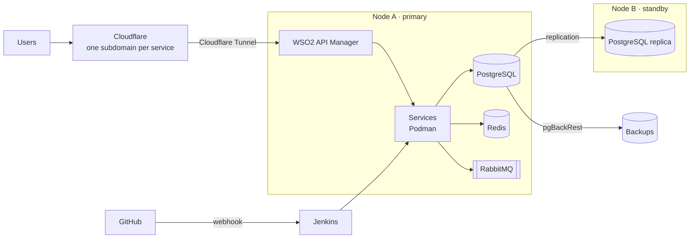

# Mandela Murithi

**Senior Backend Engineer · Java · Go · Payments**

Senior backend engineer with six years of experience building payment and banking systems for a tier-1 bank (KCB Group) and Africa's largest mobile money platform (Safaricom M-Pesa). I design event-driven services, partner APIs and settlement flows that keep money correct when the systems around them fail.

**Nairobi, Kenya (UTC+3)** · Open to remote opportunities and relocation
[puumInc@outlook.com](mailto:puumInc@outlook.com) · [LinkedIn](https://www.linkedin.com/in/mandela-murithi) · [GitHub](https://github.com/puumCore)

---

## Highlights

- **Payments at scale.** I build and own services on a multi-tenant payments platform serving **seven East African markets**, processing millions of transactions daily across mobile, card, agent and ATM channels.
- **Cross-bank settlement.** I designed and delivered loan settlement with **four partner institutions**, using idempotency and reconciliation to keep balances correct when a partner fails mid-transaction.
- **National-scale impact.** At Safaricom I worked on the marine cargo insurance platform that became the foundation of **Kenya's national digital marine insurance system**, live since July 2026.
- **Integration breadth.** I've enabled **300+ organisations** to integrate with M-Pesa and secured APIs for **20+ merchants and institutions** through WSO2 API Manager.
- **Production discipline.** I practise test-driven development, roll out changes in phases across countries, and monitor production for at least six months after release.

---

## Technical Skills

| Area | Technologies |
| --- | --- |
| **Languages** | Java (8–25), Go, SQL, C++ (working knowledge) |
| **Backend** | Spring Boot, Spring Security, Spring Cloud Gateway, Spring Data JPA / Hibernate, Apache Camel, Gin, Echo, gRPC |
| **Data** | PostgreSQL, Oracle, MongoDB, Redis, Flyway |
| **Messaging & Integration** | Apache Kafka, RabbitMQ, WSO2 API Manager, REST, gRPC, webhooks, OAuth2 / JWT, CIAM |
| **Cloud & Platforms** | Microsoft Azure, Red Hat OpenShift, Kubernetes, Docker, Podman, Cloudflare |
| **CI/CD & Quality** | Azure DevOps, Jenkins, GitHub Actions, Harbor, SonarQube, Checkmarx, Trivy |
| **Observability** | Prometheus, Grafana, Jaeger |
| **Testing** | Test-driven development, JUnit, Mockito, integration testing |
| **Practices** | Event-driven architecture, idempotency and reconciliation, multi-tenant design, code review, Scrum, AI-assisted development (Claude Code) |

---

## Experience

### Backend Developer — KCB Group
*Nov 2024 – Present · Nairobi, Kenya*

- Build and own Java/Spring Boot services on a scalable multi-tenant payments platform serving seven East African markets.
- Designed and delivered cross-bank loan settlement with four partner institutions, with idempotency and reconciliation across independently operated systems.
- Built webhooks for merchant M-Pesa STK Push APIs exposed over the internet. Transactions, notifications and audit logs flow through Kafka with retries and dead-letter handling to raise success rates.
- Engineered event-driven services where the same financial record is read and updated by several services that autoscale on OpenShift, keeping processing idempotent and consistent.
- Integrated and secured partner APIs for 20+ merchants and institutions through WSO2 API Manager, including custom XSLT/XPath mediation, and delivered CIAM for the public developer portal.
- Manage Flyway schema migrations across per-country deployments, released in phases (pilot, per-country pre-release, then release) and monitored for at least six months afterwards.
- Contributed to an Azure AD single sign-on rollout across internal bank systems.

**Stack:** Java, Spring Boot, JPA, Kafka, PostgreSQL, Oracle, Flyway, WSO2 API Manager, Azure, OpenShift, Azure Pipelines, SonarQube, Prometheus, Grafana, Jaeger

### M-Pesa Engineer — Safaricom PLC
*Mar 2023 – Nov 2024 · Nairobi, Kenya*

- Worked on the early marine cargo insurance platform, integrating the Insurance Regulatory Authority, the Kenya Revenue Authority and local underwriters so importers could insure sea shipments from their phones. It became the foundation of Kenya's national digital marine insurance system.
- Built Java/Spring Boot microservices for health, marine cargo and travel insurance products sold through M-Pesa, integrating insurers, regulators and hospital networks.
- Enabled 300+ organisations to integrate with M-Pesa for payment processing.
- Re-architected insurance APIs onto an event-driven pattern with Spring Cloud Gateway and Kafka, making processing idempotent under load.
- Designed PostgreSQL schemas, chose transaction isolation levels and ran migrations on live data without downtime.

**Stack:** Java, Spring Boot, Spring Cloud Gateway, Kafka, PostgreSQL, JPA, JUnit, Mockito

### Software Engineer — Sybyl Kenya
*Feb 2022 – Mar 2023 · Nairobi, Kenya*

- Rolled out WSO2 API Manager at Stima Sacco, the Kenya Revenue Authority and Family Bank as a secure exposure layer for core banking and tax systems, with authentication, throttling and mediation policies.
- Gathered requirements with client stakeholders and architects, and documented solutions and APIs.

**Stack:** WSO2 API Manager, Java, OAuth2

### Freelance Software Developer
*2018 – Present · Remote*

- Delivered full-stack Java applications for point-of-sale, real estate and streaming clients (2018 – 2022).
- Build and host custom software, including client sites, on my own self-managed platform behind a WSO2 API Manager gateway and Cloudflare:
  - **Viper Tattoos:** booking and portfolio platform for tattoo and piercing artists, with art visualisation before booking and MFA-secured accounts · [viper.puumcore.dev](https://viper.puumcore.dev)
  - **Self-hosted mail server:** sends email to Gmail, Microsoft and Yahoo inboxes, with webmail access · [webmail.puumcore.dev](https://webmail.puumcore.dev)
  - **NRE (Nyumba Real Estate):** SaaS property-management platform integrating smart utility meters, gate access control, maintenance requests and billing · [nre.puumcore.dev](https://nre.puumcore.dev)

**Stack:** Java 8, JavaFX, JFoenix · Java, Spring Boot, WSO2 API Manager, Podman, Cloudflare Tunnel

---

## Projects

| Project | Description | Stack | Status |
| --- | --- | --- | --- |
| **[IAM-grpc](https://github.com/puumCore)** | Authentication service exposing gRPC endpoints over Redis and PostgreSQL | Go, gRPC, Redis, PostgreSQL | Public |
| **Self-hosted platform** | Two-node infrastructure that runs my own services in production, with replication and backups (details below) | Podman, PostgreSQL, Redis, RabbitMQ, WSO2, Cloudflare Tunnel, Jenkins | Live |
| **[NRE: Nyumba Real Estate](https://nre.puumcore.dev)** | SaaS property-management platform that unifies live smart electricity and water meter readings, gate access control (fingerprint, face recognition, NFC cards and tags), tenant maintenance requests and landlord billing | Java, Spring Boot, PostgreSQL | In development · private repository |
| **[Viper Tattoos](https://viper.puumcore.dev)** | Tattoo parlour platform: artists receive and plan client bookings, sell piercings, and curate categorised portfolios; clients preview a tattoo or piercing on themselves before deciding, and share healed-result photos; artists can onboard collaborators. Accounts are secured with MFA (Microsoft or Google Authenticator) | Self-hosted behind WSO2 API Manager | Live · private repository |
| **[Mail server](https://webmail.puumcore.dev)** | Self-hosted mail server with webmail, delivering to Gmail, Microsoft and Yahoo | Podman, Cloudflare | Live |
| **Document management with redaction** | Version control and redaction for Word and PDF documents | Java, Spring Boot, Vue.js | In development |

<!-- TO DO before publishing:
     - Link any repository that is public; for private ones you can leave the name unlinked. -->

### Featured: Self-Hosted Production Platform

I host my own services on infrastructure I operate end to end, applying the same standards I use for banking systems at home: data integrity first, controlled exposure, and automated delivery.

**Key design decisions**

- **Data integrity first.** A replicated standby node, pgBackRest backups and a UPS protect against power loss and disk failure.
- **Low-latency data access.** Services and their data stores share the primary node, and the standby exists for recovery rather than load.
- **Controlled exposure.** Podman gives explicit control over exposed ports. Cloudflare Tunnel publishes each service on its own subdomain without a public IP, and WSO2 API Manager acts as the gateway in front of every service.
- **Automated delivery.** GitHub webhooks trigger Jenkins CI pipelines.

---

## Certifications & Education

| Certification | Issuer | Year |
| --- | --- | --- |
| [WSO2 API Manager (v4) Developer](https://certification.wso2.com/web/certificate/CID-03713313) | WSO2 | 2022 |
| Spring Security | Amigos Code | 2024 |
| [AI Developer Practitioner](https://skillsoft.digitalbadges-eu.skillsoft.com/profile/eu-mandelamurithimuriuki856708/wallet) | Skillsoft | 2024 |
| Java Programming & Object-Oriented Design | Institute of Advanced Technology | 2018 |

**BSc Software Engineering** · Murang'a University of Technology · 2021

---

## Let's Talk

I'm interested in backend roles in **payments and fintech**, especially where correctness, reliability and integration with external systems matter. I also enjoy building focused websites for niche audiences.

[puumInc@outlook.com](mailto:puumInc@outlook.com) · [LinkedIn](https://www.linkedin.com/in/mandela-murithi)
